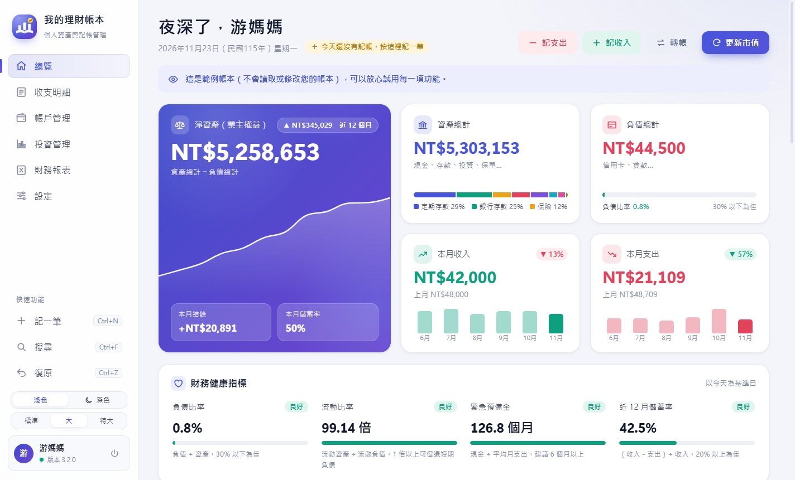
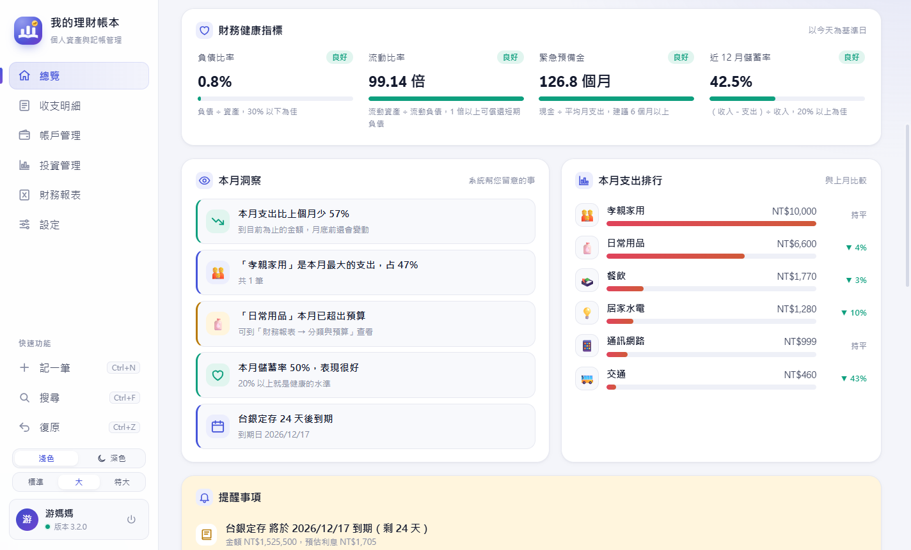
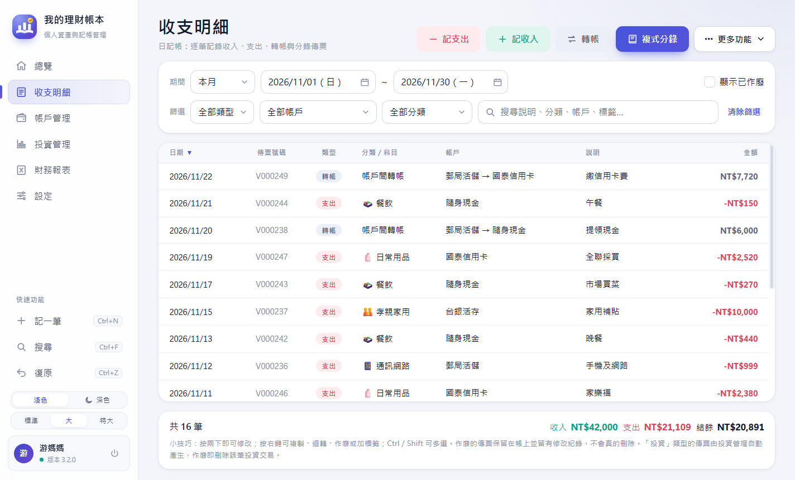
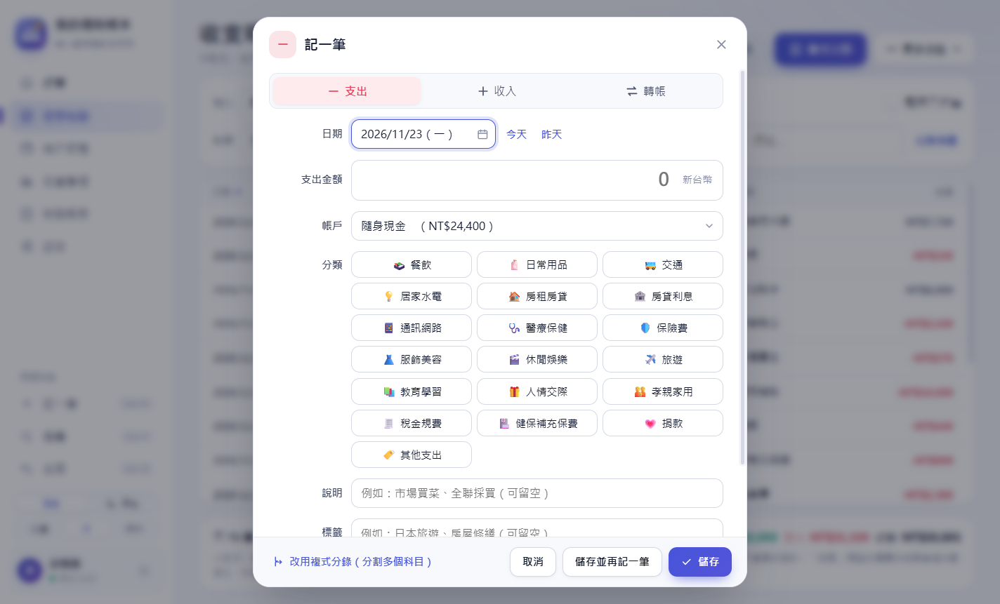
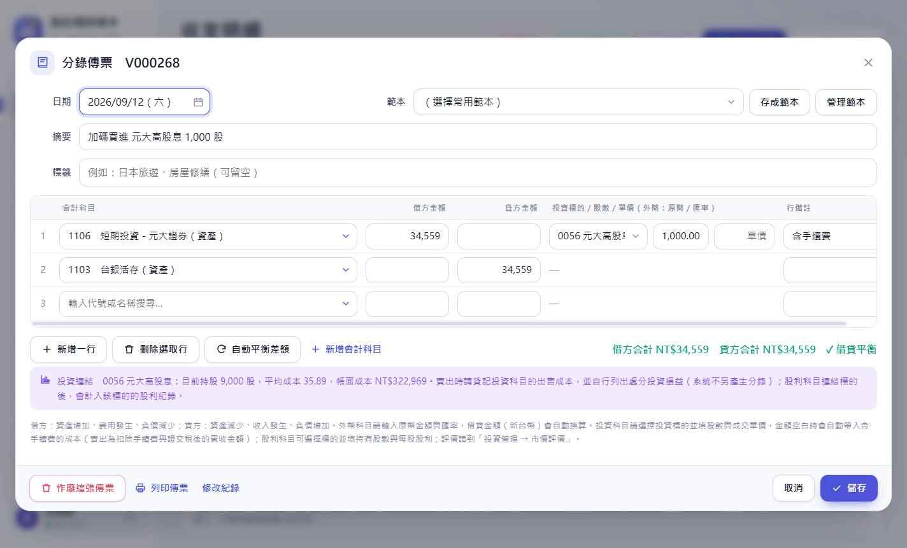
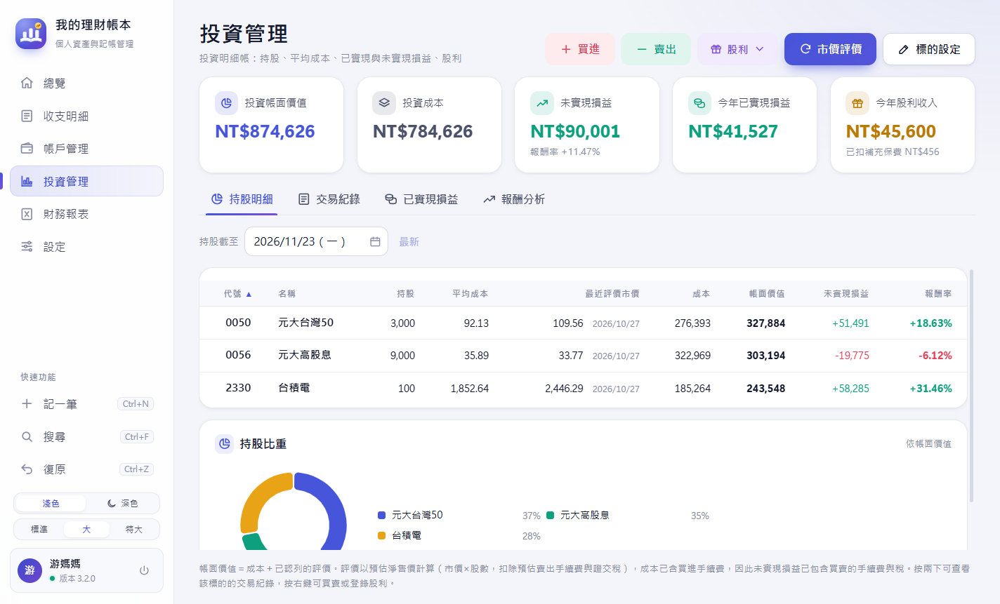
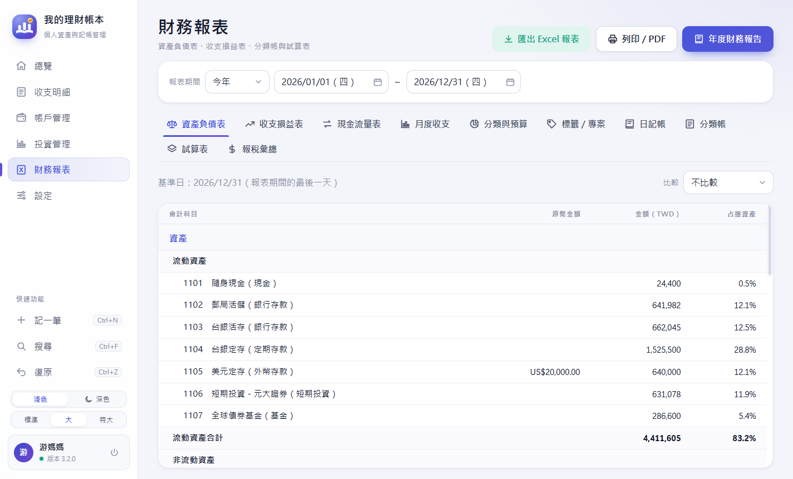
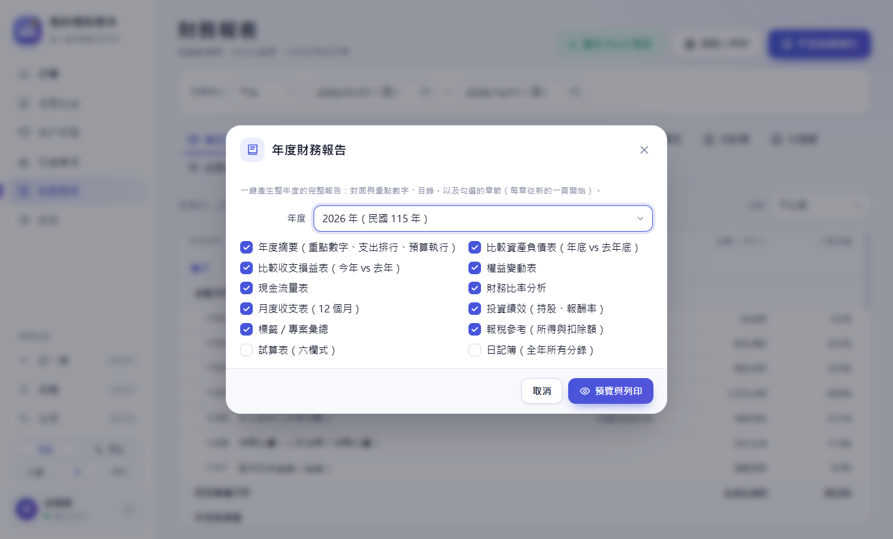
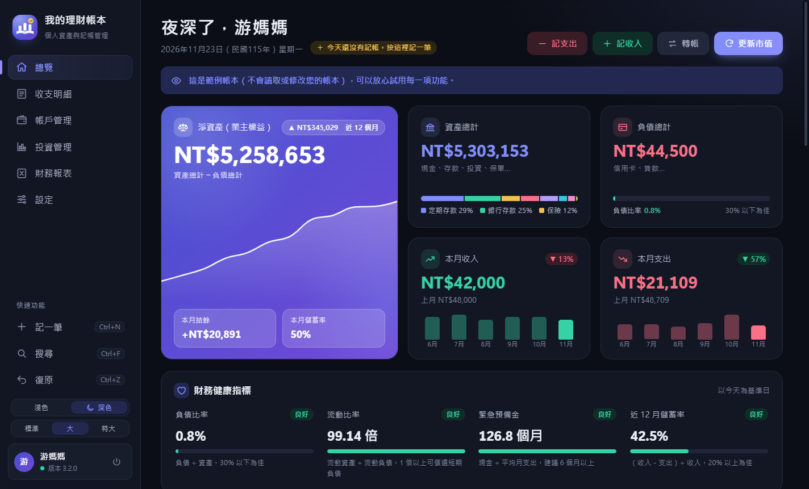

<p align="center">
  
</p>

<h1 align="center">我的理財帳本</h1>

<p align="center">
  以會計專業方式整理個人財務的 Windows 桌面程式：日記帳、分類帳、試算表、資產負債表、投資明細帳，<br>
  介面清爽、字大好讀，所有資料只存在自己的電腦。
</p>

<p align="center">
  <a href="https://github.com/coherent17/AccountApp/releases/latest/download/MyLedger.exe"><b>⬇ 下載最新版 MyLedger.exe</b></a>
  ・
  <a href="https://github.com/coherent17/AccountApp/releases">版本紀錄</a>
</p>

<p align="center"></p>

---

## 畫面一覽

| | |
|---|---|
| **本月洞察與支出排行**：用白話整理值得注意的事 | **收支明細（日記帳）**：篩選、標籤、右鍵作廢／迴轉 |
|  |  |
| **記一筆**：分類附圖示、金額可輸入算式、日期可打民國年 | **複式分錄**：多行借貸、連結投資標的、自動計算手續費 |
|  |  |
| **投資管理**：持股、平均成本、已實現／未實現損益、XIRR | **財務報表**：資產負債表、收支損益表、現金流量表…共 10 種 |
|  |  |
| **年度財務報告**：一鍵產生封面、四大報表與分析，可存成 PDF | **深色模式**與標準／大／特大字體，切換立即生效 |
|  |  |

## 功能

**記帳**
- 記一筆（支出、收入、轉帳、外幣）、複式分錄（多行借貸，含常用範本）、餘額／市值調整
- 定期交易（到期提醒、一鍵入帳）、銀行對帳（未達帳項）、憑證附件、Excel／CSV 匯入
- 標籤／專案（例如一趟旅行的總花費）、全域搜尋（Ctrl+F）、復原（Ctrl+Z）
- 作廢與迴轉（不刪除）、修改紀錄（稽核軌跡）、結帳與年度結帳鎖定

**會計與報表**
- 會計科目表：資產／負債／收入／費用科目，代號自動編碼或自訂（短期投資 11xx、長期投資 12xx）
- 日記帳、總分類帳、六欄式試算表、資產負債表（流動／非流動）、收支損益表（含業外損益、與上期或去年同期比較）
- 現金流量表（直接法，自動勾稽）、權益變動表、財務比率、報稅彙總（稅務歸類）
- 列印與 PDF（傳票、日記簿、分類帳、報表）、年度財務報告、Excel 匯出（13 張工作表，合計皆為公式）

**投資**
- 投資明細帳：買進、賣出、現金股利（自動帶入二代健保補充保費）、股票股利
- 持股、平均成本、已實現／未實現損益、總報酬率與年化報酬率（XIRR）
- 市價評價以預估淨售價計算（扣除賣出手續費與證交稅），分錄自動產生；複式分錄可直接連結標的與股數

**貼心設計**
- 總覽：淨資產走勢、本月收支、財務健康指標、本月洞察、支出排行、到期提醒
- 深色模式、三種字體大小、動畫效果可關閉；第一次使用有導覽
- 每天第一次開啟自動備份；可另設「第二份備份」到隨身碟或 OneDrive；關閉時自動完成備份
- 自動更新：有新版本會顯示更新內容，按「立即更新」即可（更新前自動備份）

## 資料安全

- 帳本存放在 `文件\我的理財帳本\理財帳本.db`，與程式分開；更新程式不會動到資料。
- 每天第一次開啟時自動備份到 `自動備份\`（保留 30 份）；更新、匯入、還原、資料結構升級之前都會先另存一份。
- 所有過去版本建立的帳本都能直接開啟，數字完全相同（每個發行版本都有測試帳本，見 `tests/fixtures/`）。
- 網路只用於檢查新版本，以及選用的收盤價與匯率（預設關閉）；不會上傳任何個人資料。

## 系統需求

- Windows 10（1809 以上）或 Windows 11，64 位元
- Microsoft Edge WebView2 Runtime：Windows 11 與一般有更新的 Windows 10 已內建；萬一沒有，程式會說明並提供微軟官方的一鍵安裝

下載 `MyLedger.exe` 後雙擊即可使用，不需要安裝。

## 自動更新

開啟程式時、以及開著的期間每 4 小時，程式會向 GitHub 查詢最新版本（可在「設定 → 網路」關閉）。有新版本時會顯示這一版的更新內容；
按「立即更新」會下載並核對 SHA-256、備份帳本、換成新版並重新開啟。選「稍後再說」則改在左側選單顯示「有新版本」，準備好時再按。

---

## 開發

### 專案結構

```
app/                會計核心（不需要 Qt）：資料庫、投資明細帳、報表、列印 HTML、匯出入、備份、復原、更新
                    （另含已停用的 v2 PySide6 介面）
v3/                 目前發行的程式
  run.py              進入點：WebView2 檢查、備份、開啟視窗、結束畫面
  api*.py             畫面呼叫的 Python 介面（每一頁一個檔案），全部交給同一個帳本執行緒
  ui/                 畫面：Preact + htm + ECharts（不需要建置步驟），lib/、pages/、dialogs/、style.css
tests/              test_v3.py（v3 介面）、test_db.py（會計核心）、test_gui.py（v2 介面）
  fixtures/           每個發行版本建立的測試帳本與帳務快照
tools/              v3_smoke.py（exe 煙霧測試）、make_icon.py、make_fixtures.py、sync_win.sh…
packaging/          myledger.spec、build.bat、app.ico、version_info.txt；legacy_v2/ 為舊版打包
docs/images/        本頁截圖
```

### 執行與測試（Windows）

```bat
python -m venv venv3 && venv3\Scripts\activate
pip install -r requirements.txt
set MY_LEDGER_V3_DEMO=1 && python v3\run.py        &REM 用暫存的範例帳本開啟（不會碰到真正的帳本）

python tests\test_v3.py                              &REM 每一本舊版帳本都要能開啟、數字與會計核心一致
python tests\test_db.py                              &REM 會計核心
```

### 打包與發行

```bat
packaging\build.bat                                  &REM → packaging\dist\我的理財帳本.exe
python tools\v3_smoke.py packaging\dist\我的理財帳本.exe   &REM 新資料夾＋所有舊版帳本，每一頁截圖，約 30 秒
```

發行：修改 `app/version.py` 與 `packaging/version_info.txt` 的版本號，把這一版的新功能寫進 `v3/whatsnew.md` → 打上 `vX.Y.Z` 標籤 → 在 GitHub Release 上傳 exe（檔名必須是 `MyLedger.exe`，自動更新依這個檔名下載），並以 `v3/whatsnew.md` 作為 Release 說明。同一份說明會出現在使用者的更新視窗，以及更新後第一次開啟時的「已更新到…」。

環境變數：`MY_LEDGER_DATA_DIR`（資料夾）、`MY_LEDGER_V3_DEMO=1`（範例帳本）、`MY_LEDGER_SMOKE_DIR`（煙霧測試截圖）、`MY_LEDGER_V3_SHOT`（開發用場景截圖）。

### 會計慣例

- 每個帳戶有「帶號餘額」：資產為正（借餘）、負債為負（貸餘）。分類帳中借方 = 帶號餘額增加。
- 收入：借 帳戶／貸 收入科目；支出：借 費用科目／貸 帳戶；轉帳：借 轉入帳戶／貸 轉出帳戶（匯差列兌換損益）；市值調整：借（貸）帳戶／貸（借）未實現評價損益。
- 試算表：資產負債科目取期末餘額，損益科目取本期發生額；期初淨值 = 期初前一日淨資產 + 期間內新開帳戶期初金額。
- 科目代號：11 流動資產、12 非流動資產、21 流動負債、22 非流動負債、3101 期初淨值、3102 淨值調整、41 收入、51 支出、7101 未實現評價損益、7201 兌換損益、7301 處分投資損益。
- 所有報表都從三個過帳檢視（`v_acc_post`、`v_cat_post`、`v_special_post`）計算，作廢傳票一律排除；外幣帳戶依目前匯率重估，差額列兌換損益，確保試算表永遠平衡。

## English summary

*My Ledger* is a Traditional-Chinese personal bookkeeping app for Windows, built for a retired accountant: double-entry journals, ledgers, a six-column trial balance, balance sheet / income / cash-flow statements, an investment sub-ledger with XIRR, annual reports and Excel export. The UI is a web front end (Preact + ECharts) shown in Edge WebView2 through pywebview; all accounting lives in the Qt-free `app/` core on SQLite. It ships as a single `MyLedger.exe`, updates itself from GitHub Releases, keeps every past release's ledger loadable (tested with a fixture per release), and stores data only on the local PC.
